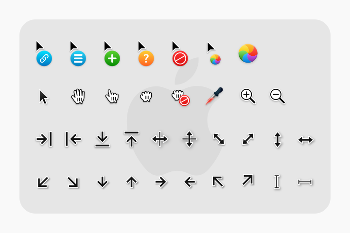

# WhiteSur Cursors

macOS-inspired x-cursor theme with HiDPI and scalable SVG support, based on [capitaine-cursors](https://github.com/keeferrourke/capitaine-cursors).

Part of the **macKali** GNOME desktop customization project.

---

## Preview



---

## Structure

```
themes/cursors/
├── build.sh            # Script to compile cursors from SVG sources
├── install.sh          # Cursor installation script
├── preview.png         # Visual preview of cursor variants
├── dist/               # Precompiled xcursors ready for installation
│   ├── cursors/        # Standard X11/Wayland cursor pixmaps and symlinks
│   ├── cursors_scalable/# Scalable SVG cursor files
│   └── index.theme     # Cursor theme metadata index
└── src/                # Cursor source files
    ├── config/         # Cursor dimension and hotspot configurations
    ├── cursorList      # Alias and symlink definitions
    └── svg/            # Master vector SVG sources
```

---

## Installation

### User Installation (Recommended)
Installs cursors for the current user into `~/.local/share/icons`:

```bash
./install.sh
```

### System-Wide Installation
Installs cursors for all system users into `/usr/share/icons`:

```bash
sudo ./install.sh --system
```

### Activating the Cursor Theme
Activate through GNOME Tweaks or the command line:

```bash
gsettings set org.gnome.desktop.interface cursor-theme 'WhiteSur-cursors'
```

### Uninstallation

```bash
./install.sh --uninstall
```

---

## Building from Source

Pre-built cursors are provided in `dist/`. If you modify any SVG assets in `src/svg/` or hotspots in `src/config/`, rebuild the package:

### Prerequisites

On Kali Linux / Debian:
```bash
sudo apt install -y xorg-xcursorgen librsvg2-bin python3 git
```

### Run Build

```bash
./build.sh
```

The script will:
1. Render multi-resolution PNG pixmaps (x1, x1.25, x1.5, x2) from the SVG vectors.
2. Compile binary xcursor files using `xcursorgen`.
3. Generate cursor symlinks and aliases specified in `src/cursorList`.
4. Optionally generate scalable SVG cursor packages.
5. Output the finished theme into `dist/`.

---

## License & Attribution

- Based on [capitaine-cursors](https://github.com/keeferrourke/capitaine-cursors) by Keefer Rourke.
- Licensed under the GNU General Public License v3.0 (see root [`LICENSE`](../../LICENSE)).
